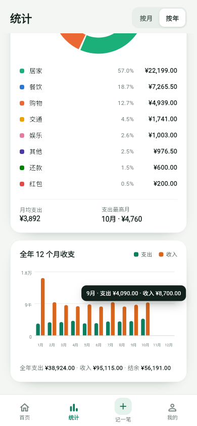
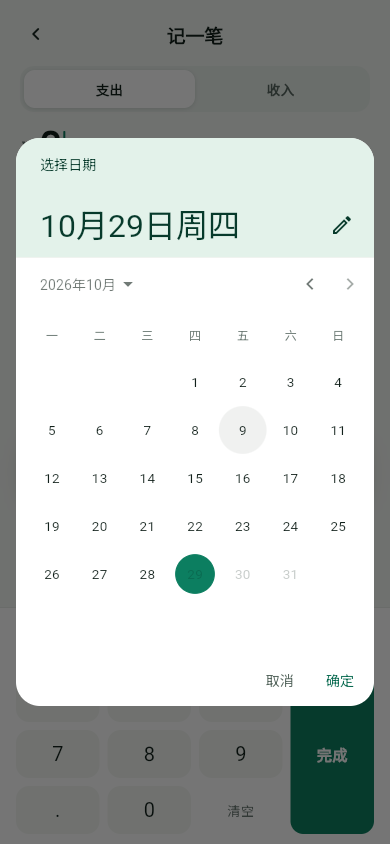

# 记账本 · entry-flow

一个薄荷绿配色的**本地优先记账 App**，使用 Flutter 原生 Widget 构建。没有登录、没有云同步、没有网络权限，账目只保存在你自己的设备上。


## 为什么是本地优先

- **不登录**：打开即用，不需要手机号、邮箱或账号
- **不联网**：Android 包未申请 `INTERNET` 权限
- **不上传**：没有云同步、统计 SDK、广告 SDK
- **可带走**：全部记录可导出为 JSON，换设备时可再导入
- **可删除**：清理数据需要两次确认，最终按钮还有 3 秒保护期

## 功能

- **首页**：本月支出 / 收入 / 结余、环比标签、按日分组的交易列表
- **记一笔**：支出/收入切换、分类、自定义数字键盘、日期、备注、金额校验
- **输入体验**：备注聚焦时顶部仍可保存；点金额区可收起系统键盘并恢复数字键盘
- **统计**：按月/按年、环形分类图、近 6 个月/全年柱状图、点击柱状图查看提示
- **单一账本**：所有记录都在日常账本中，没有多余的账本切换入口
- **数据备份**：将全部账目导出为本地 JSON，或从本地 JSON 合并/覆盖导入
- **清理数据**：两轮确认 + 最终 3 秒倒计时，倒计时结束前按钮灰色禁用
- **本地存储**：Hive 持久化，金额以「分」存储，日期使用本地 ISO-8601
- **应用图标**：深薄荷底 + 白色账本 + 暖金硬币，包含 Android 自适应图标

## 预览

以下为 Flutter 390×844 Web 渲染；真机会由系统安全区补充状态栏和底部手势条。

| 首页 | 统计（按月） | 我的 |
| --- | --- | --- |
|  |  |  |

| 统计（全年 + 柱状图提示） | 数据备份 | 日期选择 |
| --- | --- | --- |
|  |  |  |

## 应用图标

<p align="center">
  
</p>

图标源图在 [`assets/icon/`](assets/icon/)，可复现脚本为 [`tool/generate_app_icon.py`](tool/generate_app_icon.py)。已生成 Android 自适应图标、Android 传统 mipmap、iOS AppIcon、Web 图标和 Windows ICO。

## 技术栈

| 依赖 | 用途 |
| --- | --- |
| Flutter 3.47 / Dart 3.13 | 原生 UI |
| `provider` 6.1 | 状态管理与界面刷新 |
| `hive` / `hive_flutter` 2.2 / 1.1 | 本地键值数据库 |
| `intl` 0.20 | 金额格式化 |
| `flutter_localizations` | 中文日期与 Material 本地化 |
| `file_picker` 13.3 | 本地 JSON 备份的保存和选择 |

## 项目结构

```text
lib/
├─ main.dart                     # Hive 初始化 + Provider 注入
├─ app.dart                      # MaterialApp / 主 Shell / 路由
├─ app_keys.dart                 # 全局 toast
├─ models/
│  ├─ record.dart                # Record + Hive TypeAdapter + JSON
│  ├─ category.dart              # 分类定义与配色
│  └─ ledger.dart                # 单一日常账本
├─ providers/ledger_provider.dart # 记录聚合、月度统计、备份导入导出
├─ services/
│  ├─ hive_service.dart          # records + meta Box
│  └─ seed_data.dart             # 示例数据 + 单账本迁移
├─ screens/
│  ├─ home_screen.dart
│  ├─ add_record_screen.dart
│  ├─ stats_screen.dart
│  ├─ profile_screen.dart
│  └─ startup_failure_screen.dart
├─ theme/app_theme.dart
├─ utils/formatters.dart
└─ widgets/
   ├─ app_frame.dart
   ├─ bottom_nav.dart
   ├─ finance_charts.dart        # DonutChart + MonthlyBarChart
   ├─ data_backup_sheet.dart
   └─ clear_data_flow.dart
```

## 运行

需要 Flutter 3.47+、Dart 3.13+。Android 构建需要 Android SDK 和 JDK 17+。

```bash
flutter pub get
flutter run
```

Web：

```bash
flutter run -d edge
```

## 下载

正式签名的 APK 会放在 [Releases](../../releases)。目前仓库还没有上传签名包体；可以先按下方步骤从源码构建。

Android 安装时需要允许浏览器或文件管理器「安装未知应用」。这是 GitHub 侧载，不经过应用商店。

## 构建 Android APK

```bash
flutter build apk --release
```

输出：

```text
build/app/outputs/flutter-apk/app-release.apk
```

安装到已连接的 Android 设备：

```bash
adb install -r build/app/outputs/flutter-apk/app-release.apk
```

> 当前仓库里的 release 构建配置仍使用 Flutter 默认的 debug 签名，适合本地安装和测试。如果要持续分发 APK，请先配置自己的 release keystore，并把 keystore / `key.properties` 排除在版本库之外。

## 测试

```bash
flutter analyze
flutter test
```

当前覆盖 29 个测试，包含金额聚合、单账本口径、备份导入/导出、旧格式兼容、数据迁移、图表工具提示、备注聚焦保存、清理数据二次确认与倒计时等。

## 数据与隐私

- 记录保存在 Hive 的 `records` / `meta` Box，路径位于应用文档目录下的 `mint_ledger/`
- 金额以整数「分」存储，避免浮点误差
- 日期使用本地 ISO-8601 字符串，日历日不随时区偏移
- JSON 备份由用户主动选择本地目录；导入时不会联网
- 清理数据会删除全部记录，但不会删除已经导出的备份文件
- 卸载应用会删除本机数据；需要保留时请先导出备份

备份 JSON 包含全部记录和导出时间。旧版本保存的纯记录数组、旧的旅行 Demo 记录也做了兼容/过滤处理。

## 已知限制

- 统计目前只覆盖当前年份
- 预算固定为 ¥5,000，暂不支持编辑
- 暂无交易详情、编辑、删除
- 发布 APK 前需要配置正式 release 签名

## Roadmap

- [ ] 交易详情 / 编辑 / 删除
- [ ] 统计跨年浏览
- [ ] 预算编辑
- [ ] release 签名与 GitHub Release
- [ ] iOS 真机回归

## 反馈

有 bug 或建议可以提 [Issue](../../issues)。这个项目是个人本地记账工具，不提供金融服务、投资建议或云同步。

## License

暂未指定开源许可证；代码、文案和图标版权归作者所有。如需复用或转载，请先联系作者。
