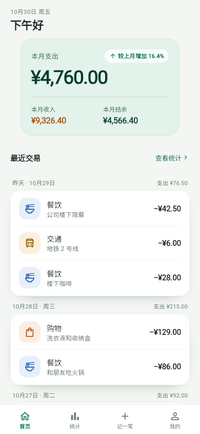
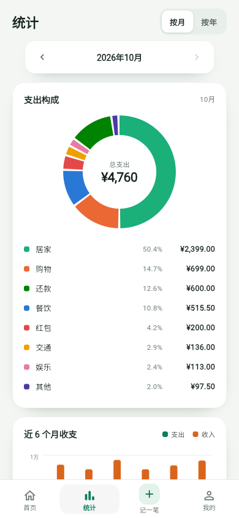
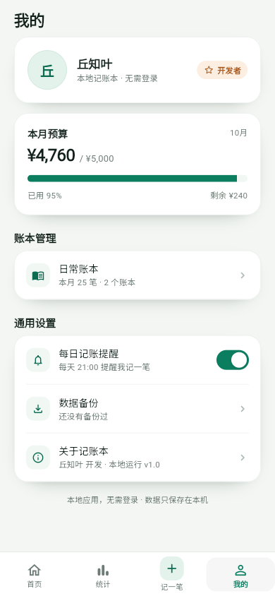
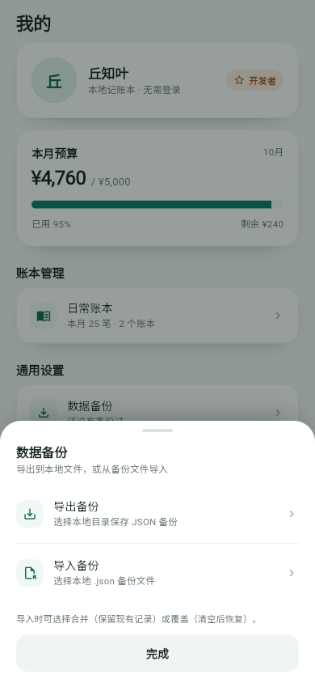

# 记账本 · entry-flow

一个薄荷绿配色的**本地优先记账 App**，Flutter 原生实现。没有登录、没有广告、没有网络权限，账目只保存在本机。



## 下载

Android APK：[Releases](../../releases/latest)。

安装时需要允许浏览器或文件管理器「安装未知应用」。这是 GitHub 侧载，不经过应用商店。

## 功能

- **首页**：本月支出 / 收入 / 结余、环比、按日交易列表
- **记一笔**：自定义数字键盘、分类、日期、备注、金额校验
- **统计**：环形分类图、近 6 个月 / 全年柱状图、按月 / 按年切换
- **数据备份**：导出 / 导入本地 JSON 文件
- **单一账本**：所有记录都在日常账本，不需要切换
- **本地数据**：Hive 存储，金额按「分」保存
- **安全清理**：两次确认 + 最终 3 秒倒计时

## 预览

| 统计 | 我的 | 数据备份 |
| --- | --- | --- |
|  |  |  |

## 运行

需要 Flutter 3.47+、Dart 3.13+。

```bash
flutter pub get
flutter run
```

测试与 Android 构建：

```bash
flutter analyze
flutter test
flutter build apk --release
```

APK 输出在 `build/app/outputs/flutter-apk/app-release.apk`。

> 仓库不包含签名密钥；本地没有 `android/key.properties` 时会回退到 debug 签名。正式发布包请配置自己的 release keystore。

## 数据与隐私

- 未申请 `INTERNET` 权限，无账号、无云同步、无统计 / 广告 SDK
- 数据保存在应用私有目录的 Hive 中；卸载应用会丢失，建议先导出备份
- 导入 / 导出只在用户主动选择文件时访问本地文件
- 「清理数据」删除全部记录，但不会删除已经导出的备份文件

## 状态

- Flutter 3.47 / Dart 3.13
- Android / iOS / Web
- Android APK v1.1.0
- 29 个测试通过，`flutter analyze` 无问题

## License

暂未指定开源许可证，代码、文案和图标版权归作者所有。
