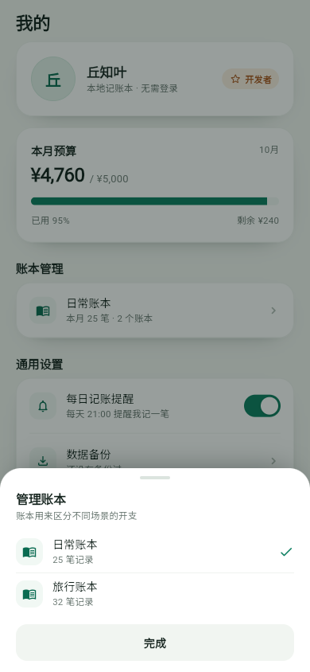
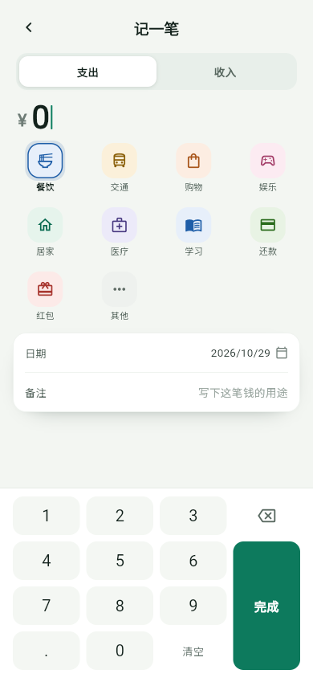

# 记账本 · entry_flow

基于 `design_ref/薄荷绿记账本-App-原型` 重写的 **Flutter 原生本地记账本**。界面全部由 Flutter Widget 构建，没有 HTML/CSS 套壳；账目通过 Hive 持久化在本机。

## 技术栈

| 依赖 | 用途 |
| --- | --- |
| `provider` 6.1 | 账本状态管理、界面实时刷新 |
| `hive` / `hive_flutter` 2.2 / 1.1 | 本地键值数据库 |
| `intl` 0.20 | 金额千分位格式化 |
| `flutter_localizations` | 中文日期选择器、Material 本地化 |
| `file_picker` 13.3 | 保存和选择本地 JSON 备份文件 |

## 已实现

- **主框架**：底部导航（首页 / 统计 / 记一笔 / 我的）、桌面端居中手机画布。四个入口统一 23px 线性图标与标签基线，「记一笔」不再使用突出的薄荷绿方块（按真机反馈调整）。
- **首页**：日期问候、本月支出/收入/结余卡片、环比标签、按日分组的交易列表、空状态；已按新版原型移除悬浮「记一笔」按钮。
- **记一笔**：支出/收入切换、分类选择、自定义数字键盘、日期选择、备注、金额校验；备注聚焦时顶部「保存」仍可用，点击金额区可收起系统键盘并恢复数字键盘；金额输入改为局部刷新，避免整页重建。保存后写入当前账本并返回刷新。
- **统计**：按月/按年切换、月份切换（限制在当前年份）、环形图与分类图例、近 6 个月/全年 12 个月柱状图、点击柱状图的深色提示浮层、年度月均支出与最高月。
- **我的**：本月预算进度、账本管理底部弹层、真实账本切换、关于信息、清理数据（两次确认 + 最终 3 秒倒计时）。
- **数据备份**：通过系统保存窗口把包含全部账目和设置的 JSON 导出到本地目录；从本地文件导入时可选合并（按 ID 去重）或覆盖。
- **账本**：`Record.ledgerId` 支持「日常账本 / 旅行账本」，切换后首页、统计、预算都会显示对应账本的真实数据；选择结果持久化在 `meta` Box。
- **本地数据**：金额以「分」存储避免浮点误差；日期用本地 ISO-8601 字符串；手写 Hive TypeAdapter 向后兼容没有 `ledgerId` 的旧记录。种子记录按 `Record.id` 作为 Hive key，旧版整数 key 在合并/删除时会按 id 兜底，避免重复记账或删不掉。
- **测试**：Provider 聚合、月度对比、账本切换、备份时间/快照持久化、备份 JSON 导出/合并/覆盖恢复、旧格式兼容、旧版整数键升级与合并、无键删除、非法日期过滤、Hive 关闭重开、示例数据迁移、首页实时刷新与持平标签、柱状图点击提示、备份弹层 UI、备注聚焦时保存、点金额区恢复键盘、年度月均口径、清理数据二次确认/3 秒倒计时，共 27 个测试。

## 预览

以下为 Flutter 390×844 实际渲染（Web 目标；真机由系统安全区补充状态栏/底部手势条）。

| 首页 | 统计（按月） | 我的 |
| --- | --- | --- |
|  |  |  |

| 统计（全年 + 柱状图提示） | 账本管理弹层 | 记一笔 |
| --- | --- | --- |
|  |  |  |

日期选择：[日期选择器截图](docs/screenshots/date-picker.png)。

真机底部导航（裁切）：[查看截图](docs/screenshots/phone-nav.png)。

数据备份弹层：[查看截图](docs/screenshots/backup-sheet.png)。

## 目录

```text
lib/
├─ main.dart                    # Hive 初始化 + Provider 注入
├─ app.dart                     # MaterialApp / 主 Shell / 路由 / 滚动行为
├─ app_keys.dart                # 全局紧凑 toast（跨路由/弹层显示）
├─ models/
│  ├─ record.dart               # Record 模型 + 手写 Hive TypeAdapter + JSON
│  ├─ category.dart             # 分类定义与配色、图标
│  └─ ledger.dart               # 日常账本 / 旅行账本
├─ providers/ledger_provider.dart  # 账本、设置、备份、统计聚合
├─ services/
│  ├─ hive_service.dart         # records + meta Box 初始化
│  └─ seed_data.dart            # 116 条原型示例数据 + 版本迁移
├─ screens/
│  ├─ home_screen.dart
│  ├─ add_record_screen.dart
│  ├─ stats_screen.dart
│  ├─ profile_screen.dart
│  └─ startup_failure_screen.dart
├─ theme/app_theme.dart         # 原型设计令牌（颜色/字号/阴影/圆角）
├─ utils/formatters.dart        # 金额、日期、问候语
└─ widgets/
   ├─ app_frame.dart            # 宽屏居中手机画布
   ├─ bottom_nav.dart
   └─ finance_charts.dart       # 环形图 + 月度柱状图（CustomPainter）
```

## 运行

```bash
# 拉取依赖
flutter pub get

# 运行（选择已连接的设备/模拟器）
flutter run

# 其他目标
flutter run -d edge
```

本机 Flutter 未加入 `PATH` 时：

```powershell
& 'D:\Software\Develop\Flutter\bin\flutter.bat' pub get
& 'D:\Software\Develop\Flutter\bin\flutter.bat' run
```

### Android APK

本机 Android SDK 在 `D:\Software\Develop\AndroidSDK`，使用 Android Studio 自带 JDK 21：

```powershell
$env:JAVA_HOME='D:\Software\Develop\AndroidStudio\jbr'
$env:ANDROID_HOME='D:\Software\Develop\AndroidSDK'
flutter build apk --release

adb install -r build\app\outputs\flutter-apk\app-release.apk
```

已验证可编译出 `app-release.apk` 并通过 adb 安装到小米手机（应用名「记账本」）。项目在 `D:`，Pub 缓存在 `C:`，`file_picker` 的 Kotlin 插件增量缓存会因跨盘路径失败，因此 `android/gradle.properties` 关闭了 `kotlin.incremental`。Windows 桌面端构建含插件的项目需要系统开启「开发者模式」（符号链接支持）。

## 本地数据说明

- 数据保存在 Hive 的 `records` / `meta` Box 中，路径位于应用文档目录下的 `mint_ledger/`。
- 示例数据共 116 条：84 条日常账本（2026 年 1–10 月）+ 32 条旅行账本，便于直接查看完整统计图。
- 示例数据是否已灌入记录在 `meta` 的 `demo_seeded` / `demo_version` 中；清空记录后不会再次注入。旧版本安装升级时会把缺失的历史月份和旅行账本补上，不会覆盖已有真实记录。
- 要使用空账本：将 `lib/services/seed_data.dart` 顶部 `kSeedDemoData` 改为 `false`，并在系统设置里清除「记账本」的应用数据后重装。
- 数据备份支持两种操作：
  - **导出备份**：生成带当前账本和全部记录的 JSON，通过系统保存窗口选择本地目录保存；
  - **导入备份**：选择本地 `.json` 备份，确认后按「合并」或「覆盖」导入。
- 导出文件名形如 `记账本备份-20261030-0940.json`；导入同时兼容旧版本保存的纯记录数组快照。
- 「清理数据」会删除全部账本记录，但不会删除已经导出到本地的备份文件；入口需要两次确认，第二轮最终按钮要等 3 秒倒计时结束才可点击。

## 下一轮

1. 交易详情：点击交易查看、编辑、删除。
2. 统计支持跨年月份/年份切换（当前沿用原型的「当前年份」范围）。
3. 应用图标/启动图、release 签名、iOS 真机回归。
